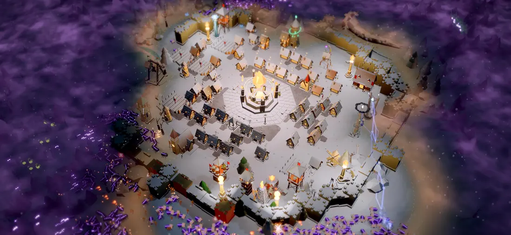
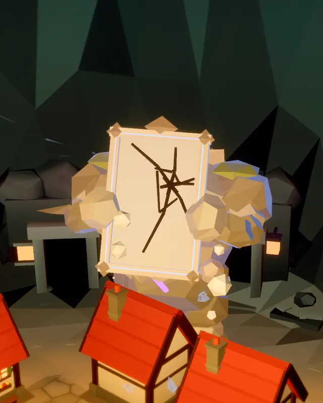

A late night in Wardlight can have up to 2,500 Blight on the field at once. The camera looks down at a steep angle on a phone screen, and at the default zoom a Crawler is about five pixels long. The kinds still have to be told apart, because they ask different things of you: a Brute needs magic, a Hexward shrugs magic off, a Bloater has to die before it reaches your wall.

This post is about how the game gets there. Much of it came from watching real nights.

## One way of building things

Every figure in the game is built the same way. The Blight are made from a handful of primitives in code: boxes, cylinders, cones, icosahedra and a small quad for each eye, with one flat colour per part. The villagers, the animals and the dwarf on the plaza use the same kit. The bosses are rigid faceted parts in flat colours as well, and each triangle's colour is jittered a little so the facets read.

On top of that sits a look pass that buildings, villagers and animals get when their meshes are built. The colour runs along the model's height, darker and a bit cooler at the foot, a touch warmer at the top. Cottages lean a little and windows are of unequal size. It is baked into the vertex colours, so it costs nothing on the GPU.

The two drawn characters follow the same idea in 2D. The dwarf and Vaelith got one line weight in a coloured stroke (warm brown on him, deep violet on her, never black) and one way of shading: a single hard-edged shadow and a single streak of shine. Hard edges are how the low-poly world is shaded, so the portraits sit closer to it. A first redraw that went further stripped the dwarf's wrinkles and red nose, so the change stayed small.

## The colours have owners

The whole game rests on one contrast: a village in warm light against a violet dark. So violet belongs to the Blight, and gold to the Wardlight. Every Blight shares a dark violet body, a violet rim and the same eyes, so a crowd reads as Blight before you read any single kind.

Inside that shared base, each kind gets one shape idea and one accent, mostly glowing and placed on the back or top where the steep camera sees it. The Crawler has a lilac ridge and spines. The Spitter carries a lime acid sac under its long neck. The Shade has magenta scythe blades, the Burrower an amber maw and ember spines, and the Wisp is a pale lavender flame.

Two hues mean more than the others. Warm red is armour: it sits on the Brute's cracks and knuckles and says "needs magic". Cold steel-white is the magic-proof: the Hexward, the Manaleech and the Husk Knight all wear it and say "needs arrows and stone". That pair is the game's central choice, so it gets the two most separated colours, and nothing else may use them.

The shapes do the rest. Flattened to one dark colour, the Crawler is a wide, low tick on spiky legs, the Hexward a tall robe, the Manaleech a slug with two bladders standing up from its back, the Brute a hunched block with a bar over its shoulder. That is what is left when the Mist has eaten the colour.

## What the playtests found

The first models looked fine up close and didn't hold up in the game. After the land bosses were done, I reworked the normal Blight because they looked too similar, and a second round followed because the Crawler, Wisp, Spitter and Burrower still read as one violet mass at night zoom.

That pass gave the three magic-proof kinds bodies of their own. Before, the Hexward was a blue-tinted Shade, the Manaleech a violet Spitter and the Husk Knight a dark Brute. A mint Spitter read like the Manaleech's mana blue at play zoom, so the Spitter stayed lime. The Hexward's rune blue and the Manaleech's cyan sat too close to frost, and the Husk Knight's violet void got lost among all the other violet. All three moved to the shared steel-white.

Rain broke it again. On a rain night every Blight is Wet, and Wet used to repaint the whole body pale blue, so the kinds and the violet were gone for the night. Now a state marks the body without repainting it: Wet, Oiled and Poisoned put their colour into the edges, streaks and highlights, and a glowing accent only leans a little toward the state's hue. The Brute's red doesn't lean at all, because a Wet Brute had turned pink right next to the Shade's magenta.

The land variants had a similar problem. Tinting the glow with the land's colour turned the Ash Crawler's ridge and the Wood Shade's blades a pale white near the steel, and the Rock-breaker's red cracks to stone. Since then the land paints the body and the mark stays the kind's.

The last pass was form. Every body was one lump, every head a box, every leg one cone. Every kind got knees, heads, jaws or tails. The crowd kinds had to stay cheap, so a knee is two open cones where one closed cone stood before, and the near Crawler went from 158 to 163 triangles.

## Marks that hold at play zoom

Good models were still too small on a phone. A Spitter's sac was one pixel, and the violet sat close to the lit ground in brightness. So I added a few rules to the horde's shaders.

Each special kind's glowing parts grow, about their own centre, until they span at least three screen points, at most three times their size. This starts 20 metres from the camera, so close-ups and the galleries stay as modelled.

The marks are also pulled a little toward the camera, so a neighbouring Crawler can't cover them, while a wall or a house in front still does. My plan had been to draw the special kinds last, but in a depth-tested 3D horde that means nothing, so this replaced it.

The Brute, the Husk Knight and the Bloater carry a hairline ring on the ground at far zoom, in their own colour, which fades out as you zoom in.

And at night a Blight body takes only half of the village's light, so on bright ground it stays a dark shape with a violet edge.

In the Mist itself you see only eyes. A body walks out of the fog a few metres past the light's edge, dark at first, so it is in plain view before it reaches the towers.

A few things help you learn the kinds. The first time a kind arrives, the night pauses on a sheet with its model turning in the light and a line on how to meet it. Kinds you haven't met yet stand on the Blight page as silhouettes. And on the early nights each side sends its kinds as separate packs, one kind at a time, and only the last nights mix them.

## Bosses and buildings

Each land's end boss is one outline you can't mistake: a burning stag with a crown of antlers, a drowned king, a giant of rock taller than the towers, a nurse on six legs, a walking rose arbour with shears, a stone figure carrying a great blank glass. They are big enough to need no marks, so the work went into holding up at night. The Glass Bearer's stone is lighter than the cliff's, and a pale rim inside its frame catches the Wardlight so you can tell its front from its back. The Mother Below was redone after she looked weak beside the other bosses, and her colours sit lighter than the horde's.

Buildings follow one rule: one silhouette each, readable at play zoom by day and by night. A playtest note said some keystone towers were not visually different. Now the buildings of one tree share material and colour and never the outline, and a keystone is the most elaborate member of its family, big enough to stand out before you read the crown of light over it. Houses are drawn at 78 % of their cells and towers at 86 %, and each house gets its own small offset, turn and tint.

One pair still blurs at default zoom: the Hexward and the Manaleech read as the same steel-white blob. I left it that way, since they ask for the same answer.

Wardlight is out [on the App Store](https://apps.apple.com/app/id6826542922).
